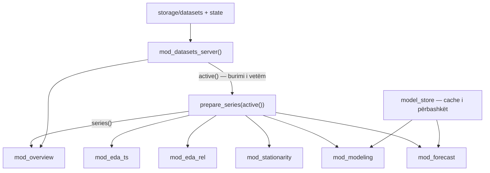

# Arkitektura e synuar (ARCHITECTURE)

> [!info] Qëllimi
> Struktura e synuar pas ristrukturimit: çfarë shkon ku, si komunikojnë pjesët dhe rregullat që ndjekim. Vendimet dhe arsyet janë te [DECISIONS.md](DECISIONS.md).

## Parimet

1. **Një përgjegjësi për file.** Çdo file bën një gjë dhe emri e tregon.
2. **Logjika e pastër ndahet nga Shiny.** Funksionet që llogaritin (parsimi, validimi, modelet, formatimi) nuk dinë asgjë për `input`/`output`. Kështu testohen lehtë.
3. **Një burim i vetëm i së vërtetës.** Dataset-i aktiv dhe konfigurimi i tij vijnë nga një vend i vetëm.
4. **Asnjë kopje.** Çdo logjikë e përsëritur bëhet funksion.
5. **Kodi ndahet nga të dhënat e përdoruesit.** Çfarë krijon përdoruesi shkon në `storage/`.

## Struktura e folderave

```
shinyapp_r/
├── app.R                     # ~40 rreshta: library(), ui, server, shinyApp()
├── install_packages.R        # instalimi i paketave (del nga README)
├── renv.lock                 # versionet e fiksuara të paketave
├── README.md
├── .gitignore
├── .gitattributes            # line endings
│
├── R/                        # Shiny i ngarkon automatikisht, pa source()
│   ├── config.R              # shtigjet, konstantet, PAGES, kufijtë
│   │
│   ├── i18n.R                # tr(), gjuha aktuale, leximi i përkthimeve (V-09)
│   ├── utils_core.R          # %||%, ndihmës të vegjël
│   ├── utils_format.R        # fmt_* dhe etiketat e kohës
│   ├── utils_paths.R         # is_path_inside_dir, resolve_*, sanitize_filename
│   │
│   ├── data_read.R           # detect_csv_delim, read_data_safe
│   ├── data_parse.R          # parse_time_safe, to_numeric_safe, detect_time_candidates, detect_numeric_cols
│   ├── data_prepare.R        # resolve_dataset_defaults, prepare_series (koha, dublikatat, grid-i)
│   │
│   ├── ts_time.R             # frekuenca, hapi, koha e ardhshme, ts_spec
│   ├── ts_validate.R         # assess_time_regular, validate_ts_ready
│   ├── ts_models.R           # fit_ets, fit_arima, run_adf, acf_pacf_data, forecast_table
│   ├── model_store.R         # cache i përbashkët i modeleve
│   │
│   ├── state_datasets.R      # datasets_state.json
│   ├── state_background.R    # background_state.json
│   ├── storage.R             # krijimi i storage/, migrimi, kopjimi i shembujve
│   ├── upload_validate.R     # validimi i fotove dhe CSV-ve
│   │
│   ├── plot_theme.R          # glass_layout(), ngjyrat, konfigurimi i Plotly
│   ├── ui_components.R       # sidebar, topbar, preloader, glass_modal(), section_box()
│   │
│   ├── mod_nav.R             # navigimi mes faqeve + titulli
│   ├── mod_datasets.R        # Settings → Dataset (Faza 4): ui, modals_ui, server → active()
│   ├── mod_background.R      # Settings → Background + Media Library
│   ├── mod_overview.R        # Përmbledhje
│   ├── mod_eda_ts.R          # EDA – Seri kohore
│   ├── mod_eda_rel.R         # EDA – Marrëdhënie
│   ├── mod_stationarity.R    # Stacionariteti
│   ├── mod_modeling.R        # Modelimi
│   └── mod_forecast.R        # Parashikimi
│
├── i18n/
│   ├── sq.json               # përkthimet shqip (gjuha e paracaktuar)
│   └── en.json               # përkthimet anglisht, të njëjtët çelësa
│
├── www/
│   ├── css/
│   │   ├── tokens.css        # variablat: ngjyrat, rrezet, hijet
│   │   ├── layout.css        # shell, sidebar, topbar, përmbajtja
│   │   ├── components.css    # karta, butona, inpute, tabela
│   │   ├── modals.css
│   │   ├── datatables.css
│   │   └── background.css    # background + media library
│   ├── js/
│   │   ├── background.js
│   │   ├── sidebar.js
│   │   ├── plotly-animate.js
│   │   ├── preloader.js
│   │   ├── filepond-bridge.js
│   │   ├── modals.js
│   │   └── color-picker.js
│   ├── vendor/
│   │   ├── filepond/
│   │   └── remixicon/        # remixicon.css + fontet e saj
│   ├── favicon/
│   └── images/               # fotot default që vijnë me app-in
│
├── data/
│   └── samples/              # dataset-et shembull (vetëm për lexim)
│
├── storage/                  # krijohet automatikisht, në .gitignore
│   ├── datasets/             # CSV-të e ngarkuara
│   ├── images/               # fotot e ngarkuara
│   └── state/                # datasets_state.json, background_state.json, settings.json (gjuha)
│
└── tests/
    ├── reference/            # vlerat referencë nga versioni aktual
    ├── fixtures/             # 10 CSV për raste të veçanta (QUALITY.md)
    └── testthat/
        ├── helper-app.R      # ngarkon R/ me loadSupport() në një sandbox
        ├── test-config.R
        ├── test-data_parse.R
        ├── test-data_prepare.R
        ├── test-plot_theme.R
        ├── test-state.R
        ├── test-ts_validate.R
        ├── test-ts_models.R  # Faza 5
        ├── test-utils_format.R
        ├── test-utils_paths.R
        ├── test-i18n.R       # Faza 3
        └── test-mod_datasets.R  # Faza 4 (testServer, Q04–Q08)
```

### Nga ku vjen çdo pjesë e kodit aktual

| Kodi aktual | Shkon te |
|---|---|
| `library()` në krye të `helpers.R` | `app.R` |
| `%||%` | `utils_core.R` |
| `get_app_dir`, `DATA_DIR`, `STATE_FILE`, `BG_STATE_FILE` | `config.R` |
| `read_state` … `get_dataset_config` | `state_datasets.R` |
| `normalize_app_path`, `is_path_inside_dir`, `resolve_*`, `sanitize_filename` | `utils_paths.R` |
| `validate_bg_upload_file` | `upload_validate.R` |
| `detect_csv_delim`, `read_data_safe` | `data_read.R` |
| `parse_time_safe`, `to_numeric_safe`, `detect_time_candidates` | `data_parse.R` |
| `make_label`, `build_meta`, `var_meta`, `fmt_*`, `time_axis_label`, `fmt_time` | `utils_format.R` |
| `plotly_cfg`, `find_traces`, `set_trace_text`, `skip_trace_hover` | `plot_theme.R` (të fundit zhduken me `plot_ly`) |
| `make_df_dyn`, `apply_dup_policy`, `apply_freq_policy` | `data_prepare.R` |
| `infer_step_from_time`, `make_future_time`, `ts_spec_from_time`, `detect_freq_from_time`, `canonical_freq_key`, `date_period_*`, `expected_time_grid` | `ts_time.R` |
| `assess_time_regular`, `assess_complete_series`, `validate_ts_ready`, `TS_*_MSG` | `ts_validate.R` |
| `default_bg_state` … `write_bg_state` | `state_background.R` |
| `.h_step`, `.h_unit`, `.h_bounds`, `.roll_cap_by_step` | `ts_time.R` + `config.R` |
| Logjika ADF / ETS / ARIMA nga `server_plots.R` | `ts_models.R` (funksione të pastra) |
| UI e sidebar-it, topbar-it, modaleve | `ui_components.R` |
| Server-i i dataset-eve nga `app.R` | `mod_datasets.R` |
| Server-i i background-it nga `app.R` | `mod_background.R` |
| Çdo bllok output-esh nga `server_plots.R` | `mod_<faqja>.R` |

## Rrjedha e re e të dhënave



## Kontratat mes pjesëve

### `active()` — nga `mod_datasets_server()`
```r
list(
  file       = "Digjitalizimi_Financiar_Shqiperi_data.csv",
  data       = <data.frame, kolonat si tekst>,
  time_col   = "Data",
  value_cols = c("Internet_Pct", "Transaksionet_Online")
)
# ose NULL kur nuk ka dataset
```
Zbatuar në Fazën 4. Kolona e kohës dhe seritë zgjidhen te moduli: konfigurimi i ruajtur → zgjedhja e dataset-it të mëparshëm → default-et (T-15). Modalet e modulit hapen e mbyllen vetëm me `toggle_glass_modal(session, id, "show" | "hide")` (P-08); `mod_datasets_modals_ui()` i vendos në fund të faqes (`app_page(main_tabs, modals)`).

### `series()` — nga `prepare_series(active())`
```r
list(
  data       = <data.frame: Time + seritë numerike, të renditura, në grid të rregullt>,
  value_cols = c(...),
  meta       = list(<kolona> = list(label = "...", unit = "")),
  time_label = "Data" | "Viti" | "Koha",
  freq_key   = "monthly" | "yearly" | ... | NULL,
  step_unit  = "muaj" | "vite" | ...
)
```
`prepare_series()` është funksion i pastër (pa Shiny). Testohet direkt. Në Fazën 4 kthen vetëm `data`, `value_cols` dhe `meta` (T-14); `time_label`, `freq_key` dhe `step_unit` shtohen në Fazën 5.

### Modulet e analizës
Çdo faqe ka të njëjtën formë:
```r
mod_eda_ts_ui     <- function(id) { ns <- NS(id); ... }
mod_eda_ts_server <- function(id, series) {
  moduleServer(id, function(input, output, session) { ... })
}
```
- Merr `series` (reaktiv), nuk lexon kurrë JSON apo inpute globale.
- Zgjedhësi i serisë dhe slider-at janë brenda modulit (`ns("series")`, `ns("h")`).
- Modelimi dhe Parashikimi marrin edhe `fits` nga `model_store`.

### `model_store`
Cache i përbashkët (me `cachem`, që vjen me Shiny), me çelës hash-in e serisë + llojin e modelit. Nëse Modelimi ka llogaritur `auto.arima` për një seri, Parashikimi e merr gati.

### `app.R` i ri (skicë)
```r
library(shiny); library(plotly); library(forecast); # ...

ui <- app_page(                       # nga ui_components.R
  mod_datasets_ui("datasets"),
  mod_background_ui("background"),
  mod_overview_ui("overview"),
  mod_eda_ts_ui("eda_ts"),
  mod_eda_rel_ui("eda_rel"),
  mod_stationarity_ui("stationarity"),
  mod_modeling_ui("modeling"),
  mod_forecast_ui("forecast")
)

server <- function(input, output, session) {
  init_storage()
  mod_nav_server("nav")
  active <- mod_datasets_server("datasets")
  series <- reactive(prepare_series(active()))
  fits   <- model_store()

  mod_overview_server("overview", active, series)
  mod_eda_ts_server("eda_ts", series)
  mod_eda_rel_server("eda_rel", series)
  mod_stationarity_server("stationarity", series)
  mod_modeling_server("modeling", series, fits)
  mod_forecast_server("forecast", series, fits)
  mod_background_server("background")
}

shinyApp(ui, server)
```

## Lista e faqeve — një vend i vetëm (`config.R`)
Zbatuar në Fazën 3. ID-të janë ato ekzistuese (`tab_<id>`, `go_<id>`), sepse i përdorin JS dhe `background_state.json`; tekstet vijnë nga i18n (`page.<id>.menu`, `page.<id>.title`).
```r
PAGES <- list(
  list(id = "settings",   nav = FALSE),
  list(id = "overview",   nav = TRUE),
  list(id = "eda_ts",     nav = TRUE),
  list(id = "eda_rel",    nav = TRUE),
  list(id = "stationary", nav = TRUE),
  list(id = "modeling",   nav = TRUE),
  list(id = "forecast",   nav = TRUE)
)
```
Nga kjo listë gjenerohen:
- butonat e sidebar-it
- titujt e topbar-it
- kartat e background-it për çdo faqe
- harta që i dërgohet JS-it

`sidebar.js` dhe `bg.js` nuk kanë më ID të shkruara me dorë: lexojnë atributin `data-nav-tab` të butonave të sidebar-it.

## Storage dhe migrimi
- `init_storage()` krijon `storage/datasets`, `storage/images` dhe `storage/state` nëse nuk ekzistojnë.
- **Migrimi bëhet një herë** (shënuesi `storage/state/storage.json`, T-08): kopje rezervë e JSON-eve të `data/`; CSV-të e `data/` dhe dataset-et e listuara në state që mungojnë (nga `data/samples/`); JSON-et. Çdo kopje verifikohet me md5. `data/` nuk preket.
- **Hapja e parë pa të dhëna:** nëse `storage/datasets` mbetet bosh, kopjohen shembujt nga `data/samples/`.
- `storage/state/settings.json` mban gjuhën (`read_settings()`/`write_settings()`).
- `APP_DIR` (të dhënat) dhe `CODE_DIR` (`i18n/`, `data/samples/`) janë i njëjti folder në app; testet i ndajnë (T-09).
- **Fotot:**
  - Fotot e ngarkuara shërbehen me `addResourcePath("user-images", "storage/images")`.
  - Fotot default mbeten te `www/images/`.
  - Në state ruhet `images/...` ose `user-images/...`.

## Grafikët
- Bëhen direkt me `plot_ly()` në vend të `ggplot()` + `ggplotly()`. Janë më të shpejtë, hover-i kontrollohet direkt dhe zhduken trukat me `find_traces`.
- `glass_layout(p, title, x, y)` vendos sfondin transparent, ngjyrat, fontin dhe margjinat në një vend.
- Ngjyrat e serive janë në `config.R`:
  - e vëzhguar: e bardhë
  - ETS / mesatare lëvizëse: blu
  - ARIMA / parashikim: e kuqe
- **Animacioni:** çdo grafik i animueshëm merr klasën `anim-plot`. `plotly-animate.js` i gjen me klasë, jo me ID të fiksuara. ID-të e moduleve bëhen p.sh. `eda_ts-raw`.

## Rregullat e kodit

**Shiny:**
- Asnjë `showNotification` brenda `render*` ose `reactive()`. Njoftimet vetëm për veprime të përdoruesit (ruajtje, fshirje, ngarkim). Për gjendje të pavlefshme përdoret `validate(need(...))`.
- Asnjë efekt anësor (shkrim në disk, update i inputeve) brenda `reactive()`.
- Modulet përdorin vetëm `ns()` për ID-të, pa ID globale.
- Asnjë input i fshehur si "urë" mes pjesëve.

**Kodi:**
- Funksionet e pastra jetojnë në file pa prefiksin `mod_`. Çdo funksion i ri i pastër merr test.
- Emrat janë `snake_case`. Modulet emërtohen `mod_<faqja>_ui` / `mod_<faqja>_server`.
- **Asnjë tekst i dukshëm direkt në kod:** çdo tekst kalon nga `tr("çelësi")`, me përkthim në `i18n/sq.json` dhe `i18n/en.json` (V-09). Kodi dhe emrat e funksioneve janë në anglisht.
- Formatimi i numrave merr gjuhën aktuale; vlerat nuk ndryshojnë.

**Frontend:**
- JS komunikon me Shiny vetëm me `Shiny.setInputValue` dhe custom messages, të regjistruara një herë.
- CSS: pa `!important` të ri, përveç kur mbishkruhet Bootstrap ose DataTables.
